  

# Awesome Geo-Location & Price Localization 🌍 💳 🚀

  
  
  
  
  
  
  

> **A curated directory of SaaS platforms, API engines, and open-source GitHub projects for market-specific dynamic pricing, currency localization, geo-targeting, and purchasing power parity (PPP).** 🌐 💰

---

## 📖 Overview

Adapting prices and offers to local consumer purchasing power and currency expectations is one of the highest-leverage growth strategies for modern SaaS, digital products, and international e-commerce. **Price localization** spans multiple architectural tiers:
- 💳 **Billing Localization & Merchant of Record (MoR):** Multi-currency checkout, automated foreign exchange (FX) conversion, and automated local tax calculation (VAT/GST/Sales Tax).
- ⚖️ **Purchasing Power Parity (PPP) & Geo-Pricing:** Adjusting price indexes dynamically according to country-level GDP per capita or cost-of-living metrics (e.g., Big Mac Index) via IP geolocation.
- 📈 **Enterprise Price Optimization (PO&M):** Advanced algorithmic elasticity modeling, constraint-based margin management, and B2B CPQ (Configure, Price, Quote).
- 🎯 **Geo-Targeting & Personalization:** Serving regional product catalogs, contextual landing pages, and localized promo banners based on visitor geolocation.

---

## 📑 Table of Contents
- [📊 Sector Overview & Market Dynamics](#-sector-overview--market-dynamics)
- [🏢 SaaS & Hosted Platforms](#-saas--hosted-platforms)
- [🛠️ Open-Source GitHub Projects](#️-open-source-github-projects)
  - [🛒 Open-Source Commerce & Billing Engines](#-open-source-commerce--billing-engines)
  - [⚖️ Purchasing Power Parity & Geo-Pricing Tools](#️-purchasing-power-parity--geo-pricing-tools)
  - [📍 GeoIP & Location Detection Libraries](#-geoip--location-detection-libraries)
  - [💱 Currency Conversion & Exchange Rate APIs](#-currency-conversion--exchange-rate-apis)
  - [🚩 Feature Flags & Experimentation Engines](#-feature-flags--experimentation-engines)
- [🏗️ Architectural Considerations](#️-architectural-considerations)
- [🌟 Star History](#-star-history)
- [💖 Support](#-support)
- [🤝 How to Contribute](#-how-to-contribute)
- [⚠️ Disclaimer](#️-disclaimer)

---

## 📊 Sector Overview & Market Dynamics

The global price optimization and commercial localization software sector is valued at approximately **$1.95B to $2.0B in 2026** (scaling past **$9.7B** when factoring in broader enterprise Quote-to-Cash, CPQ, and revenue management suites), compounding at ~16.5% CAGR. The market remains **moderately to highly fragmented**, bifurcated between multi-billion-dollar enterprise CPQ/ERP suites (e.g., PROS, Vendavo, Pricefx), specialized Merchant of Record and subscription billing platforms (e.g., Chargebee, Paddle), and high-growth experimentation and personalization engines (e.g., Bloomreach, Dynamic Yield). No single vendor exercises winner-take-all dominance across all layers, driving sustained M&A activity and hybrid architectures pairing open-source geo-infrastructure with commercial billing backends.

---

## 🏢 SaaS & Hosted Platforms

The table below outlines leading SaaS platforms for pricing optimization, geo-personalization, and international billing infrastructure. Entries are sorted in descending order by company size (valuation or annual revenue).

| Product | Company Size (Valuation / Revenue) | Description | Starting Pricing | Free Tier / Trial Limits |
|:---|:---|:---|:---|:---|
| **[Chargebee](https://www.chargebee.com/)** | **$3.5B Valuation** (~$200M+ ARR) | Subscription management & recurring billing platform with native multi-currency support, regional tax compliance (VAT, GST), smart gateway routing, and localized catalog management. | **$0/mo base** on Starter plan; **$599/mo** (billed annually) for Performance plan (includes up to $100k/mo MRR + 0.75% overage). | **Free up to $250,000** cumulative lifetime billing on Starter plan (0.75% overage fee applies thereafter); includes test site sandbox limited to 150 API calls/min. |
| **[Bloomreach](https://www.bloomreach.com/)** | **$2.2B Valuation** (~$150M+ ARR) | E-commerce personalization & discovery platform. Contexts in Data Hub tailor product data, localized prices, and regional availability across stores and markets from a single catalog. | **~$35,000 to $60,000/year** entry-level contract (modular base fee plus usage-based pricing). | **No free tier.** Guided demo available upon request; developer public sandbox available for CMS testing. |
| **[PROS Smart CPQ](https://www.pros.com/)** | **$1.4B Valuation** (~$351M TTM Revenue) | Enterprise AI-powered CPQ and dynamic pricing suite. Features real-time multi-currency Converted Price Widgets and multi-language localized quoting templates. | **$60/user/month** (Essentials tier); Advantage/Omnichannel tiers range from **$75–$95+/user/month**. | **No free tier.** Standardized self-serve trial unavailable; custom guided enterprise demo and PoC via sales. |
| **[Dynamic Yield](https://www.dynamicyield.com/)** | **$320M Valuation** (Acquired by Mastercard) | Real-time personalization and A/B testing OS (Experience OS) providing dynamic geo-location, weather, behavioral, and device-level offer adaptation. | **~$35,000/year** starting annual contract (scaled by monthly unique visitors and module footprint). | **No free tier.** Standardized trial unavailable; sales-led demo and enterprise proof-of-concept upon request. |
| **[Vendavo](https://www.vendavo.com/)** | **~$100M+ ARR** (PE-backed by Accel-KKR) | B2B price management, dynamic deal guidance, and intelligent CPQ supporting multi-geography value-based and competitive pricing strategies. | **~$75,000 to $200,000/year** (annual enterprise contract based on revenue under management and user seats). | **No free tier.** Standardized trial unavailable; tailored enterprise demo available upon request. |
| **[Pricefx](https://www.pricefx.com/)** | **~$88M Revenue** (Backed by Apax Digital) | Cloud-native modular pricing optimization and CPQ software suite covering price setting, customer segmentation analytics, and rebate management. | **~$50,000 to $150,000/year** annual subscription (plus one-time enterprise implementation fees). | **No free tier.** Standardized trial unavailable; tailored enterprise demonstration available upon request. |
| **[Zilliant](https://www.zilliant.com/)** | **~$35M ARR** (PE-backed by Madison Dearborn) | AI-driven B2B price optimization, Price IQ elasticity engine, and margin guidance integrating across CRM, ERP, and digital commerce. | **~$60,000 to $150,000/year** (annual contract value based on catalog size and transaction volume). | **No free tier.** Standardized trial unavailable; customized demonstration via sales consultation. |
| **[Monetate](https://www.monetate.com/)** | **~$20M Revenue** (Centre Lane Partners) | E-commerce experimentation and personalization suite featuring geo-targeting, automated audience segmentation, and personalized banner/price triggers. | **~$35,000 to $45,000/year** starting contract (scaled dynamically by annual visitor traffic and domains). | **No free tier.** Standardized trial unavailable; custom product demo available via sales. |
| **[Omniconvert Explore](https://www.omniconvert.com/)** | **~$1M ARR** (Bootstrapped / Venture-backed) | Conversion rate optimization and experimentation SaaS featuring native IP/geo-targeting, weather-condition triggers, and dynamic on-page price testing. | **$245/month** starting paid tier (for traffic up to 100k visitors/mo). | **Free forever plan** up to **50,000 tested visitors/month** with full Explore feature access (no credit card required; experiments pause if visitor limit is exceeded). |

---

## 🛠️ Open-Source GitHub Projects

Open-source tooling enables developers to implement localized pricing, geo-IP resolution, currency conversion, and purchasing power parity adjustments without high per-seat or per-traffic SaaS lock-in. 

Entries across each category are sorted in descending order by GitHub star count.

### 🛒 Open-Source Commerce & Billing Engines

Self-hosted commerce frameworks and billing infrastructure supporting multi-currency pricing, geographic tax jurisdictions, and regional store localization.

| Project | Star Badge | Description |
|:---|:---|:---|
| **[Medusa](https://github.com/medusajs/medusa)** |  | Composable, headless commerce platform with built-in multi-region architecture, native multi-currency pricing, custom regional tax providers, and automated shipping zones. |
| **[Kill Bill](https://github.com/killbill/killbill)** |  | Open-source subscription billing and payments platform. Handles multi-currency invoices, payment routing, tenant-level localization, and self-hosted financial pipelines. |

### ⚖️ Purchasing Power Parity & Geo-Pricing Tools

Libraries and automation scripts designed to calculate and apply purchasing power parity (PPP) multipliers and country-specific pricing tiers.

| Project | Star Badge | Description |
|:---|:---|:---|
| **[purchasing-power-parity](https://github.com/purchasing-power-parity/purchasing-power-parity)** |  | Dynamic web application and country pricing multiplier calculator to adjust software and digital product prices globally based on World Bank PPP factors. |
| **[appstore-ppp-pricing-agent-skill](https://github.com/duceum/appstore-ppp-pricing-agent-skill)** |  | CLI tool and agent skill to bulk-update App Store in-app purchases and subscription prices across 175+ countries using purchasing power parity indexes. |
| **[datasets/ppp](https://github.com/datasets/ppp)** |  | Clean, machine-readable dataset of World Bank Purchasing Power Parity (PPP) conversion factors and national price level ratios across global economies. |
| **[ppp-pricing](https://github.com/iosdevmax/ppp-pricing)** |  | Python scripts and utilities for mobile developers to calculate purchasing power parity adjustments across Apple App Store and Google Play pricing tiers. |

### 📍 GeoIP & Location Detection Libraries

High-performance IP geolocation engines and database readers to identify visitor country, region, and ISP at the edge or server level.

| Project | Star Badge | Description |
|:---|:---|:---|
| **[node-geoip](https://github.com/geoip-lite/node-geoip)** |  | Lightweight native Node.js implementation of MaxMind GeoIP database lookup. Fast, in-memory IP-to-country mapping without external network overhead. |
| **[GeoIP2-php](https://github.com/maxmind/GeoIP2-php)** |  | Official MaxMind GeoIP2 PHP reader providing localized location and country metadata for web applications. |
| **[geoip2-golang](https://github.com/oschwald/geoip2-golang)** |  | Fast Go reader for MaxMind DB files (`.mmdb`), widely used in high-throughput microservices and edge reverse proxies for visitor geo-resolution. |
| **[laravel-geoip](https://github.com/Torann/laravel-geoip)** |  | Laravel integration package to determine visitor geographic location, currency, and country code with built-in caching support. |

### 💱 Currency Conversion & Exchange Rate APIs

Open-source real-time and historical foreign exchange rates engines to automate multi-currency conversion calculations.

| Project | Star Badge | Description |
|:---|:---|:---|
| **[exchange-api](https://github.com/fawazahmed0/exchange-api)** |  | Free, open-source currency exchange rates API tracking 200+ currencies and cryptocurrencies with daily automated updates and zero rate limits. |
| **[swap](https://github.com/florianv/swap)** |  | Robust PHP currency conversion and exchange rate library aggregating rates from 30+ financial providers with fallback and caching strategies. |

### 🚩 Feature Flags & Experimentation Engines

Self-hosted experimentation tools to run geo-targeted A/B pricing tests, regional promotional banners, and location-based feature rollouts.

| Project | Star Badge | Description |
|:---|:---|:---|
| **[GrowthBook](https://github.com/growthbook/growthbook)** |  | Open-source feature flagging and A/B testing platform with targeting by custom user attributes (including country, IP, and currency) and Bayesian statistics. |
| **[Flagsmith](https://github.com/Flagsmith/flagsmith)** |  | Open-source feature flag and remote configuration engine supporting geographic user segmentation, remote value overrides, and multivariate experiments. |

---

## 🏗️ Architectural Considerations

When implementing geo-location and price localization in production, keep in mind:

1. ⚖️ **Billing Localization vs. Price Optimization:**
   - *Billing Localization* (e.g., Chargebee, Medusa, Kill Bill) handles multi-currency presentation, payment gateway routing, and tax compliance (VAT/GST). It solves operational transaction mechanics, not price elasticity.
   - *Price Optimization* (e.g., PROS, Pricefx, Zilliant) algorithmically determines optimal willingness-to-pay and margin thresholds. Open-source solutions typically do not provide proprietary elasticity engines, which remain primarily commercial.
2. 🛡️ **Purchasing Power Parity (PPP) Pitfalls:**
   - Beware of VPN abuse where users spoof locations to gain discounted prices. Recommended defenses include restricting regional discount codes to locally issued credit cards, verifying billing addresses, or utilizing payment methods limited to specific regions.
3. 🔒 **Data Privacy & Regulation:**
   - Comply with GDPR, CCPA, and regional privacy mandates regarding IP address collection and geolocation tracking. Avoid non-transparent, predatory price discrimination practices that violate local consumer protection regulations.

---

## 🌟 Star History

---

## 💖 Support

Thank you for exploring this curated repository! If you find this collection helpful for your projects, architecture, or pricing strategy, please consider supporting the project:

- ⭐ **Star this repository** on GitHub to increase visibility.
- 🍴 **Fork and contribute** new tools, corrections, or updates.
- 📢 **Share this repo** with your engineering, growth, and pricing teams.
- ☕ **Buy me a coffee / Sponsor:** If you would like to support continuous maintenance and new awesome lists, visit the [GitHub Sponsors Dashboard](https://github.com/sponsors/ishandutta2007).

---

## 🤝 How to Contribute

1. 🍴 Fork this repository.
2. 🌿 Create a new branch: `git checkout -b feature/new-tool`.
3. 📝 Add the SaaS platform or open-source repository following the established table structure.
   - For SaaS tools: include verified starting pricing and exact free tier/trial limits.
   - For open-source tools: verify the project is actively maintained and include its official star badge linking to `/stargazers`.
4. 💾 Commit your changes: `git commit -m "Add <tool-name> to localization tools"`.
5. 🚀 Open a Pull Request with a clear summary of the tool's relevance.

---

## ⚠️ Disclaimer

This list is community-curated for informational and architectural evaluation purposes. Mention of specific vendors does not constitute an endorsement. Always verify current licensing, terms of service, and privacy regulations prior to deploying pricing or geolocation systems in production.
